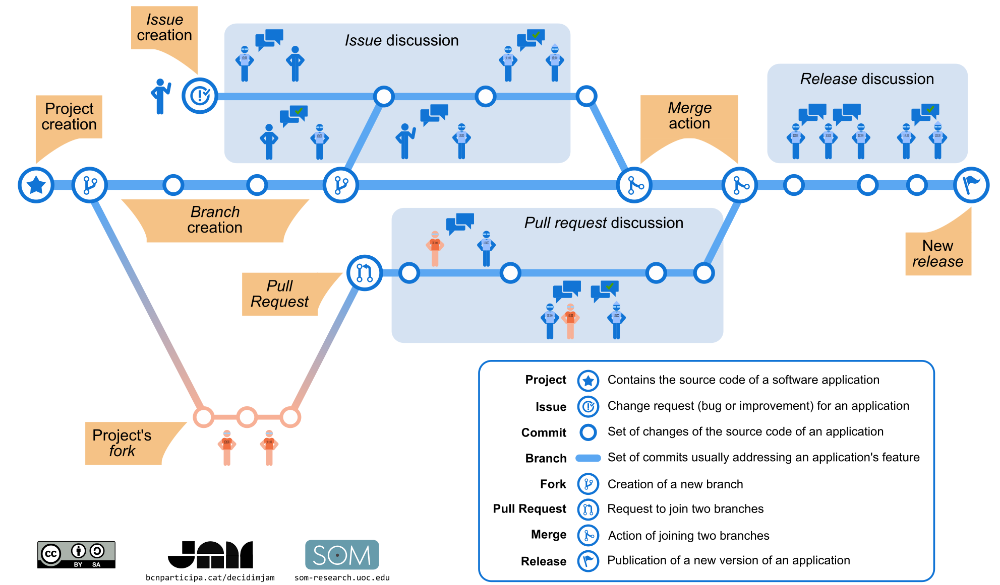

# Git 3 : branches et pull requests

**Objectif** : travailler sans risque sur une branche et proposer une modification par pull request.

## 1. Pourquoi une branche ?

La branche `main` doit rester **propre** : c'est la version qui fait foi. Pour essayer une correction, une nouvelle section ou une idée, on crée une **branche** : une ligne de travail parallèle. Si le résultat est bon, on la fusionne dans `main` ; sinon, on la jette sans dommage.

```text
main     ●────●────●─────────────●   (fusion)
                    \           /
correction           ●────●────●
```

## 2. Créer une branche et y travailler

**Avec GitHub Desktop**

1. Menu `Current Branch` (en haut) > `New Branch`.
2. Nom : `correction-strophe-2`, puis `Create Branch`.
3. Modifiez `poeme.txt`, faites un commit comme d'habitude : il est enregistré **sur la branche**.
4. Cliquez sur `Publish branch` pour l'envoyer sur GitHub.

**Dans le terminal**

```bash
git switch -c correction-strophe-2
# modifier poeme.txt
git add poeme.txt
git commit -m "Corrige la strophe 2"
git push -u origin correction-strophe-2
```

Pour revenir sur `main` et constater que votre modification n'y est pas encore : `git switch main` (ou le menu `Current Branch`).

## 3. La pull request

Le schéma suivant montre la vie d'un projet : branches, issues, fork, pull request, fusion, version publiée.



*Schéma sous licence CC BY-SA ; auteurs indiqués sur l'image : JAM (bcnparticipa.cat/decidimjam) et SOM Research (som-research.uoc.edu).*

Une **pull request** (PR) demande de fusionner une branche dans `main`. Elle permet de **relire** les changements, de les commenter, puis de les accepter. Dans un projet à plusieurs, c'est le moyen normal de contribuer.

1. Dans GitHub Desktop, après avoir publié la branche : **Create Pull Request** (ou sur github.com, bandeau jaune `Compare & pull request`).
2. Donnez un titre et une description : *quoi*, et *pourquoi*.
3. Sur la page de la PR, onglet `Files changed` : les lignes ajoutées et supprimées. On peut y laisser des commentaires.
4. Si tout est bon : **Merge pull request** puis **Confirm merge**.
5. Supprimez la branche (`Delete branch`) : elle n'a plus d'utilité.
6. Revenez sur `main` dans GitHub Desktop et faites `Pull origin` : votre ordinateur récupère la fusion.

> Sur **GitLab**, la même chose s'appelle une **merge request** (MR).

## Exercice

1. Créez une branche `ajout-notes`, ajoutez un fichier `notes.md` avec trois remarques sur le poème, faites-en un commit et publiez la branche.
2. Ouvrez une pull request vers `main`, puis fusionnez-la.
3. Revenez sur `main`, faites `Pull origin` : le fichier `notes.md` doit apparaître.

Étape suivante : [04-bilan.md](04-bilan.md)

---

## Pour aller plus loin (hors séance)

## Le conflit

Un conflit survient quand **deux versions modifient la même ligne** et que git ne peut pas deviner laquelle garder. Ce n'est pas une erreur : c'est une question posée par git.

**Provoquer un conflit volontairement** (dans votre dépôt, seul) :

1. Depuis `main`, créez la branche `version-a` ; changez la première ligne du poème en `Sensation (Rimbaud)` ; commit.
2. Revenez sur `main`, créez la branche `version-b` ; changez **la même ligne** en `Sensation, 1870` ; commit.
3. Revenez sur `main` et fusionnez `version-a` : cela passe.
4. Fusionnez ensuite `version-b` :
   - **GitHub Desktop** : `Branch > Merge into current branch…`, choisissez `version-b`. Une fenêtre annonce un conflit.
   - **Terminal** : `git merge version-b`.

**Résoudre**

Le fichier contient maintenant des **marqueurs** :

```text
<<<<<<< HEAD
Sensation (Rimbaud)
=======
Sensation, 1870
>>>>>>> version-b
```

- ce qui est entre `<<<<<<<` et `=======` : la version de la branche courante ;
- ce qui est entre `=======` et `>>>>>>>` : la version de l'autre branche.

Ouvrez le fichier dans un éditeur de texte, **gardez ce que vous voulez** (ici, par exemple, `Sensation (Rimbaud, 1870)`), **supprimez les trois lignes de marqueurs**, enregistrez. Puis :

- **GitHub Desktop** : le fichier passe en vert, cliquez sur `Continue merge`.
- **Terminal** :

```bash
git add poeme.txt
git commit -m "Fusionne version-a et version-b"
```

> Si vous êtes perdu au milieu d'une fusion, `git merge --abort` annule tout et revient à l'état d'avant.

**Éviter les conflits** : faites un `pull` avant de travailler, des commits courts et fréquents, et ne travaillez pas à deux sur la même ligne.

## Collaborer avec d'autres personnes

Deux façons de contribuer à un projet qui n'est pas le vôtre :

- **être ajouté comme collaborateur** (`Settings > Collaborators` sur le dépôt) : vous pouvez pousser des branches directement ;
- **forker** : `Fork` crée une copie du dépôt sur *votre* compte ; vous y travaillez, puis vous ouvrez une pull request vers le dépôt d'origine. C'est ainsi que l'on contribue aux projets libres.

Les **Issues** (onglet `Issues`) servent à signaler un problème ou noter une tâche. Un commit dont le message contient « Corrige #3 » ferme l'issue n° 3 une fois fusionné.

### Exercices facultatifs

1. Provoquez et résolvez un conflit comme ci-dessus.
2. En binôme, ajoutez votre voisin ou voisine comme collaborateur, et fusionnez la pull request de l'autre.
3. Forkez le dépôt de ce cours, corrigez une coquille et ouvrez une pull request.
