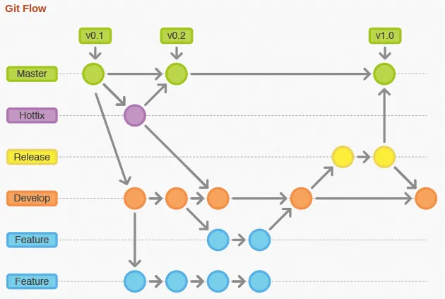

# Git 5 : pour aller plus loin (facultatif)

Rien de ce qui suit n'est nécessaire pour la séance : à faire chez soi, selon vos besoins.

## 1. Le conflit

Un conflit survient quand **deux versions modifient la même ligne** et que git ne peut pas deviner laquelle garder. Ce n'est pas une erreur : c'est une question posée par git.

**Provoquer un conflit volontairement** (dans votre dépôt, seul) :

1. Depuis `main`, créez la branche `version-a` ; changez la première ligne du poème en `Sensation (Rimbaud)` ; commit.
2. Revenez sur `main`, créez la branche `version-b` ; changez **la même ligne** en `Sensation, 1870` ; commit.
3. Revenez sur `main` et fusionnez `version-a` : cela passe.
4. Fusionnez ensuite `version-b` :
   - **GitHub Desktop** : `Branch > Merge into current branch…`, choisissez `version-b`. Une fenêtre annonce un conflit.
   - **Terminal** : `git merge version-b`.

**Résoudre**

Le fichier contient maintenant des **marqueurs** :

```text
<<<<<<< HEAD
Sensation (Rimbaud)
=======
Sensation, 1870
>>>>>>> version-b
```

- ce qui est entre `<<<<<<<` et `=======` : la version de la branche courante ;
- ce qui est entre `=======` et `>>>>>>>` : la version de l'autre branche.

Ouvrez le fichier dans un éditeur de texte, **gardez ce que vous voulez** (ici, par exemple, `Sensation (Rimbaud, 1870)`), **supprimez les trois lignes de marqueurs**, enregistrez. Puis :

- **GitHub Desktop** : le fichier passe en vert, cliquez sur `Continue merge`.
- **Terminal** :

```bash
git add poeme.txt
git commit -m "Fusionne version-a et version-b"
```

> Si vous êtes perdu au milieu d'une fusion, `git merge --abort` annule tout et revient à l'état d'avant.

**Éviter les conflits** : faites un `pull` avant de travailler, des commits courts et fréquents, et ne travaillez pas à deux sur la même ligne.

## 2. Collaborer avec d'autres personnes

Deux façons de contribuer à un projet qui n'est pas le vôtre :

- **être ajouté comme collaborateur** (`Settings > Collaborators` sur le dépôt) : vous pouvez pousser des branches directement ;
- **forker** : `Fork` crée une copie du dépôt sur *votre* compte ; vous y travaillez, puis vous ouvrez une pull request vers le dépôt d'origine. C'est ainsi que l'on contribue aux projets libres.

Les **Issues** (onglet `Issues`) servent à signaler un problème ou noter une tâche. Un commit dont le message contient « Corrige #3 » ferme l'issue n° 3 une fois fusionné.

## 3. Branches, releases, publication et citation



- **Un flux de travail à plusieurs branches** : `main` reste stable, une branche `dev` reçoit les modifications, et chaque nouvelle fonctionnalité (*feature*) a sa propre branche, fusionnée dans `dev`, puis dans `main` quand tout fonctionne. En cas d'urgence, une branche dédiée corrige le problème sans toucher au reste.
- **Les releases** : une version du dépôt marquée par une étiquette (*tag*) : `0.1`, `1.0`… Sur GitHub, `Releases > Draft a new release`. C'est utile pour citer une version précise d'un corpus ou d'un programme.
- **Citer son dépôt** : un fichier `CITATION.cff` à la racine, et l'archivage du dépôt sur [Zenodo](https://zenodo.org/), qui donne un DOI.
- **Publier un site** : un dépôt GitHub peut servir de serveur web avec [GitHub Pages](https://pages.github.com) (dépôt nommé `NomDuDepot.github.io`, page d'accueil `index.html`). Pour un site plus travaillé, voir [MkDocs](https://www.mkdocs.org) (ligne de commande). Pour distinguer votre personne de vos projets, créez une **organisation**.
- **Pour approfondir** : le livre [Pro Git](https://git-scm.com/book/fr/v2) (en français, gratuit) et la [documentation de GitHub Desktop](https://docs.github.com/fr/desktop).

## Exercices facultatifs

1. Provoquez et résolvez un conflit comme dans la partie 1.
2. En binôme, ajoutez votre voisin ou voisine comme collaborateur, et fusionnez la pull request de l'autre.
3. Forkez le dépôt de ce cours, corrigez une coquille et ouvrez une pull request.
